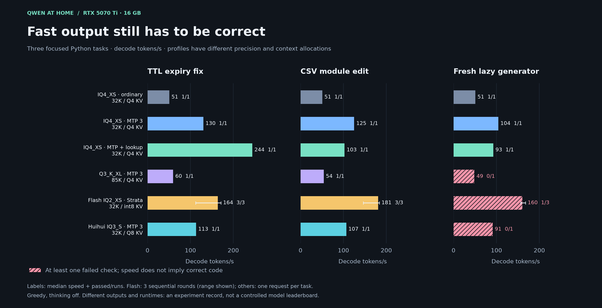
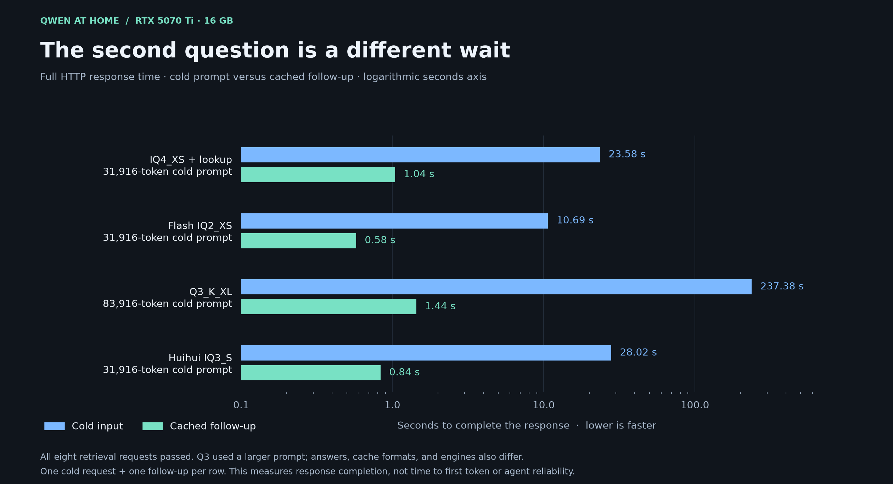
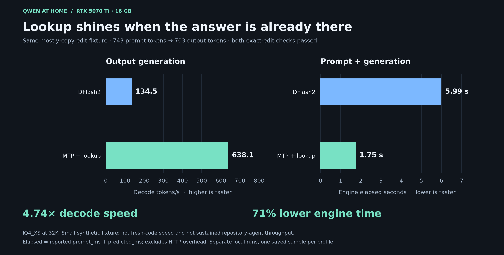
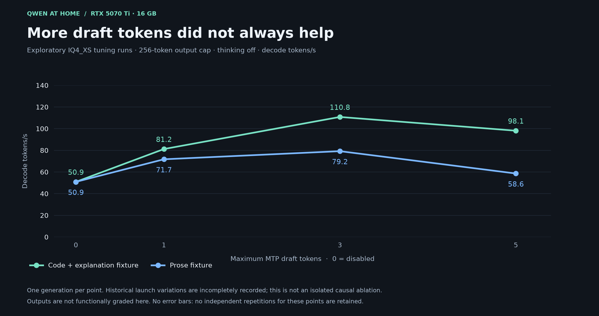

# Visual benchmark gallery

Four figures generated directly from the retained JSON. PNG versions render on GitHub; SVG versions remain sharp when zoomed or printed. The same figures are embedded in the [offline HTML documentation](index.html#charts), which remains self-contained.

## Coding speed and correctness



[SVG](assets/coding-speed-and-correctness.svg) · [PNG](assets/coding-speed-and-correctness.png)

Each panel is a different task. Flash uses three sequential rounds, with median and min/max range; the other profiles have one request per task. Failed outputs remain visible rather than being presented as useful-code performance. All requests here used greedy decoding and thinking off. Model, runtime, cache precision, and context allocation differ.

Sources: [IQ4_XS](../data/Qwen38-benchmark-results.json), [Q3_K_XL](../data/Qwen38-Q3-85K-results.json), [Flash](../data/QwenFlash-benchmark-results.json), [Huihui](../data/Huihui-Qwen38-results.json).

## Cold versus cached response latency



[SVG](assets/context-cache-latency.svg) · [PNG](assets/context-cache-latency.png)

One cold request and one follow-up per configuration, all with successful retrieval. Q3 uses 83,916 cold prompt tokens; the other rows use 31,916. A longer bar means more waiting; the axis is logarithmic. Response lengths and configurations also differ. These are HTTP completion times, not time to first token or a test of an entire agent workflow.

Sources: the context/context_checks arrays in the four result files linked above.

## Lookup on a mostly-copy edit



[SVG](assets/lookup-workload.svg) · [PNG](assets/lookup-workload.png)

Both exact-edit checks passed. This retained 703-token output largely repeats the 743-token input. Lookup recorded 4.74 times the decode speed and 71% less engine elapsed time; engine elapsed excludes HTTP overhead. It does not predict that speed for fresh code or everyday chat.

Sources: [DFlash2](../data/sweeps/qwen38-dflash-small-edit.json), [MTP plus lookup](../data/sweeps/qwen38-lookup-small-edit.json).

## Exploratory MTP draft depth



[SVG](assets/mtp-draft-sweep.svg) · [PNG](assets/mtp-draft-sweep.png)

The fixtures were capped at 256 generated tokens, thinking off, with no functional correctness grading. There is one generation per plotted point, so no repeat-based uncertainty is available. Historical launch variations are incompletely recorded; these are observations, not a controlled causal sweep. Do not treat the connecting lines as measurements at intermediate depths.

Sources: [disabled](../data/sweeps/qwen38-mtp0.json), [depth 1](../data/sweeps/qwen38-mtp1-fullgpu.json), [depth 3](../data/sweeps/qwen38-mtp3-fullgpu.json), [depth 5](../data/sweeps/qwen38-mtp5.json).

## Regenerate

Use a separate Python environment with Matplotlib installed. The figures were generated with Matplotlib 3.11.2. No GPU, model download, or inference server is needed.

```sh
python -m pip install matplotlib==3.11.2
python benchmarks/plot_results.py
```

Run the script from the repository root, or pass its absolute path from another directory. It reads `data/`, writes four PNG/SVG pairs under `docs/assets/`, and updates only the chart section and its styling in `docs/index.html`. It does not overwrite benchmark measurements or run generated model code. The Matplotlib dependency is optional for readers; the committed images and HTML work without it.
